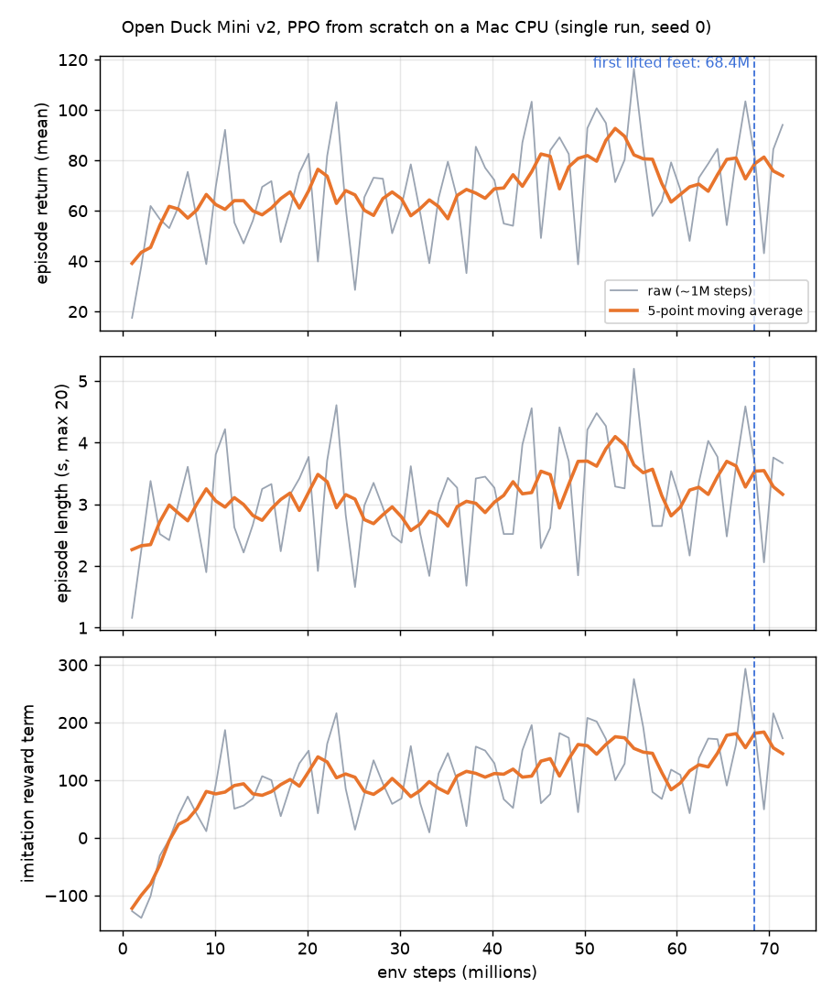

<sub>Left: 0 steps, sampled with exploration noise (seed 2): falls. Middle: our policy at 68.4 M steps, the first checkpoint that lifts its feet. Right: the pretrained `BEST_WALK_ONNX` from Open_Duck_Mini (not trained by us). Simulation only.</sub>

# open-duck-mac

**Teach Open Duck Mini v2 to walk from scratch on a MacBook, CPU only.**

This repository contains the scripts and the logs behind a short video: [Open Duck Mini v2](https://github.com/apirrone/Open_Duck_Mini) learning to walk with PPO in [Open_Duck_Playground](https://github.com/apirrone/Open_Duck_Playground), on an Apple Silicon Mac with JAX on the CPU, MJX physics and Brax PPO. The environment, rewards and robot model are Antoine Pirrone's, **unchanged**. What is ours is a small Mac runner, a TensorFlow-free ONNX exporter, a rollout evaluator and the numbers of one real run.

[Run it](#run-it) · [Results](#results-of-our-run) · [What this is not](#what-this-is-not) · [Credits](#credits-and-licence) · [Türkçe özet](#türkçe-özet)

## Results of our run

One run, one seed (0), 24 October 2026, on an Apple M5 MacBook (10 CPU cores, 6 used) that was also rendering other videos at the time.

| | |
|---|---|
| Wall-clock time | **3.57 h** (04:15:55 → 07:50:08) |
| Environment steps | **72,437,760** (≈ 48 % of the official 150 M recipe) |
| Parallel ducks | 1,536 (6 CPU devices × 256 envs) |
| Episodes | 429,369 (falls and 20 s time-outs together; the log does not separate them) |
| Speed | 5,636 env steps/s on average (1,924 – 7,358 per chunk) |
| Simulated time | 72.4 M × 0.02 s ≈ 16.8 days, about 113× real time |
| Checkpoints | 19, one every 4,024,320 steps |

What the policy did, measured with [`eval_checkpoint.py`](scripts/eval_checkpoint.py): flat floor, no pushes, forward command 0.15 m/s, 5 s, deterministic policy. The "9 noisy ducks" column samples actions with the exploration noise, as in training ([`eval_grid.py`](scripts/eval_grid.py)).

| Checkpoint | Wall-clock | Forward distance in 5 s | Feet | 9 noisy ducks |
|---|---|---|---|---|
| 0 steps | 0 min | 0.4 cm (stands frozen) | no steps | **8 of 9 fall** |
| 4.0 M | **10 min 45 s** | 1.2 cm | no steps | 0 of 9 fall |
| 8 M – 64.4 M | 29 – 196 min | 2.1 – 4.3 cm | no steps (feet lift ≤ 6 mm) | 0 of 9 fall |
| **68.4 M** | 205 min | **29.8 cm** | first lifted feet, ~1.2 cm | 0 of 9, mean 18 cm |
| 72.4 M (last) | 214 min | **28.8 cm** | small, shuffling steps | 0 of 9, mean 22 cm |
| `BEST_WALK_ONNX` (pretrained, not ours) | – | **58.5 cm** | 8 + 8 clean steps | – |

In short: within about **11 minutes** it learned to stay on its feet, then sat on that plateau for **about 3 hours**, and only between 64.4 M and 68.4 M steps did it start lifting its feet. At 72.4 M it covers half the distance of the pretrained policy in the same test. A 0.15 m/s command would be 75 cm in 5 s, so even the pretrained policy is below the target here.



Mean episode return went from 17.5 (first 1 M steps) to 78.3 (mean of the last 10 M), episode length from 1.2 s to 3.5 s (limit 20 s). The clearest learning signal is the imitation term: −127 → +168. Everything is in [`results/2026-10-24/`](results/2026-10-24/): `train_log.csv` (one table), `train_log_raw.csv`, `checkpoints.csv`, `ckpt_summary.json`, `train_metrics.jsonl` (PPO losses, steps/s per chunk), `run_config.json` (exact PPO parameters), `sim/*.json` (every rollout measurement) and the ONNX policies at 68.4 M and 72.4 M steps. `make_log.py` rebuilds `train_log.csv` and `ckpt_summary.json` from these files byte for byte.

**Why CPU?** We tried the Mac's GPU first. With `jax-metal 0.1.1` + `jax 0.4.34` + `mujoco-mjx 3.2.3`, compiling the MJX step fails with `failed to legalize operation 'mhlo.cholesky'`: the Metal plugin does not support an operation the physics needs. That is missing software support, not a hardware limit. Everything here runs on the CPU.

**The CPU trick.** One JAX CPU device with multi-threaded XLA reached 2,368 raw env steps/s (1,024 envs). Splitting the CPU into 6 virtual devices with one thread each (`--xla_force_host_platform_device_count=6 --xla_cpu_multi_thread_eigen=false`) lets Brax `pmap` across cores: 4,621 steps/s with 6 × 256 envs, about 2× faster. `train_mac.py` sets this for you.

## Run it

You need an Apple Silicon Mac, [uv](https://docs.astral.sh/uv/) and about 4 hours for the full run. Linux CPUs should work too, but we only ran it on macOS.

**1. Get this repo and the environment at the pinned commit.**

```bash
git clone https://github.com/fport/open-duck-mac.git
cd open-duck-mac

git clone https://github.com/apirrone/Open_Duck_Playground.git external/Open_Duck_Playground
git -C external/Open_Duck_Playground checkout b9be205ac64488c23504ca42e5ec790337adeec3
```

`b9be205` (5 Aug 2025, "fix onnx export") is the commit we trained on.

**2. Create the environment.** `requirements-lock.txt` is the exact environment of our run; `requirements.txt` lists only the direct dependencies.

```bash
uv venv --python 3.12 .venv
uv pip install --python .venv/bin/python -r requirements-lock.txt

# mujoco_playground clones the whole mujoco_menagerie on first import; this robot does not need it.
# An empty folder skips the clone.
mkdir -p "$(.venv/bin/python -c 'import importlib.util, os; print(os.path.dirname(importlib.util.find_spec("mujoco_playground").origin))')/external_deps/mujoco_menagerie"
```

**3. Smoke test** (a minute or two, mostly compilation).

```bash
.venv/bin/python -I scripts/smoke.py external/Open_Duck_Playground --envs 64
.venv/bin/python -I scripts/smoke_pmap.py external/Open_Duck_Playground --devices 6 --envs_per_dev 256
```

Use the second one to pick `--devices` for your Mac: the number of cores that gives the most steps/s, leaving a few free.

**4. Train**, exactly as we ran it (`run_config.json`):

```bash
nice -n 10 .venv/bin/python -I scripts/train_mac.py external/Open_Duck_Playground runs/my-run \
  --devices 6 --envs_per_dev 256 --num_timesteps 72000000 --num_evals 19 --seed 0 \
  --render_script scripts/eval_checkpoint.py
```

Brax rounds the step count up to whole PPO iterations, so 72,000,000 ends at 72,437,760. After every chunk (~9 min on our machine) you get `runs/my-run/ckpt/ckpt_<steps>.onnx` and `.pkl`, a line in `checkpoints.csv`, and, with `--render_script`, a background 5 s rollout video plus measurements in `runs/my-run/sim/`. Leave `--render_script` out to save CPU. The official recipe is `--num_timesteps 150000000`; we stopped at 48 %.

**5. ONNX.** The trainer already writes one ONNX per checkpoint, with the same interface as Open_Duck_Playground's exporter (input `obs` 1×101, output `continuous_actions`), so it also loads in the upstream `mujoco_infer.py`. To re-export a saved checkpoint:

```bash
.venv/bin/python -I scripts/onnx_export.py runs/my-run/ckpt/ckpt_072437760.pkl my_policy.onnx
```

**6. Evaluate a checkpoint** (deterministic, 5 s, 0.15 m/s) and the 9-seed noisy test:

```bash
.venv/bin/python -I scripts/eval_checkpoint.py external/Open_Duck_Playground \
  runs/my-run/ckpt/ckpt_072437760.onnx runs/my-run/sim/ckpt_072437760.mp4
.venv/bin/python -I scripts/eval_grid.py external/Open_Duck_Playground \
  runs/my-run/ckpt/ckpt_000000000.onnx runs/my-run/sim/ckpt_000000000_grid.mp4
.venv/bin/python scripts/make_log.py runs/my-run      # train_log.csv, ckpt_summary.json, reward_curve.png
```

Add `--no_video` for numbers only. Our own policies are in `results/`, so you can test without training: `eval_checkpoint.py external/Open_Duck_Playground results/2026-10-24/onnx/ckpt_072437760.onnx out/c72.mp4 --no_video` prints `"dx_m": 0.2882`, and `eval_grid.py` on a fresh seed-0 step-0 checkpoint gives `"fell": 8` as in the table. For the pretrained comparison, download [`BEST_WALK_ONNX.onnx`](https://github.com/apirrone/Open_Duck_Mini/blob/b23317a485b3cec7d8417f352478778b3475173c/BEST_WALK_ONNX.onnx) from Open_Duck_Mini and run the same command on it (`"dx_m": 0.5845`).

### Scripts

| Script | What it does |
|---|---|
| [`train_mac.py`](scripts/train_mac.py) | Brax PPO on the unchanged `joystick.py` env (flat terrain), `BerkeleyHumanoidJoystickFlatTerrain` hyperparameters, pmap over virtual CPU devices; logs, ONNX + params per checkpoint |
| [`onnx_export.py`](scripts/onnx_export.py) | Brax policy params → ONNX with plain `onnx` (no TensorFlow/tf2onnx); also outputs `loc_out`/`scale` for noisy sampling |
| [`smoke.py`](scripts/smoke.py), [`smoke_pmap.py`](scripts/smoke_pmap.py) | Does the env compile and step, and how fast, on one device or D devices |
| [`eval_checkpoint.py`](scripts/eval_checkpoint.py) | Rollout of an ONNX policy in C MuJoCo with upstream `MjInfer`; distance, falls, foot steps; optional video |
| [`eval_grid.py`](scripts/eval_grid.py) | The same with exploration noise for 9 seeds; how many fall, mean distance, optional 3×3 video |
| [`make_log.py`](scripts/make_log.py) | Raw logs + rollout JSONs → `train_log.csv`, `ckpt_summary.json`, `reward_curve.png` |

Every script prints its usage with `--help`.

### Expected time on your Mac

Our M5 (10 cores, 6 devices × 256 envs) averaged 5,636 steps/s while other jobs were running, so 72 M steps took 3.6 h and 150 M would take about 7.5 h. Chunks ran at 1,924 – 7,358 steps/s depending on the load, so an idle machine should be faster. The first compile takes a few minutes. Fewer cores means proportionally longer; run `smoke_pmap.py` to estimate (training also spends time on the PPO update, so expect less than the smoke-test number).

## What this is not

- **Not the official recipe.** Upstream trains 150 M steps with 8,192 envs on an NVIDIA GPU (`jax[cuda12]`). We used 1,536 envs, a smaller batch, no evaluation runs, and stopped at 72.4 M. We do not know how `BEST_WALK_ONNX` was trained.
- **Not a walking robot yet.** At 72.4 M steps it shuffles 29 cm in 5 s with small steps. It is a first gait, not a good one.
- **Not statistics.** One run, one seed. Another seed would lift its feet at a different step; "68 M" belongs to this run only.
- **Not Microduck**, and **no real robot**. Everything is simulation. The ONNX has the upstream interface, but we have not run it on hardware.
- **Not identical physics in evaluation.** Training runs in MJX, the evaluation in C MuJoCo with the same model and control loop; small numerical differences are possible. After the trunk tips over, `eval_checkpoint.py` makes the robot's meshes collide with the floor so a falling duck does not sink through it on video (in training only the feet touch the floor and a fall ends the episode). "Fell" in our tables means tipped more than 60°, stricter than training's 90°.
- **Not a fork.** Open_Duck_Playground is used as is, from a pinned commit; nothing here modifies it.

## Credits and licence

- **Open Duck Mini v2** and **Open_Duck_Playground** by [Antoine Pirrone](https://github.com/apirrone) and contributors: robot, MJCF model, `joystick.py` environment, rewards, reference motion (`polynomial_coefficients.pkl`), `mujoco_infer.py` and the pretrained `BEST_WALK_ONNX`. Open_Duck_Mini is Apache-2.0. Open_Duck_Playground's source files carry Apache-2.0 headers, but its repository root had no LICENSE file at `b9be205`.
- **[MuJoCo Playground](https://github.com/google-deepmind/mujoco_playground)**, **[MuJoCo / MJX](https://github.com/google-deepmind/mujoco)** and **[Brax](https://github.com/google/brax)** by Google DeepMind and contributors, Apache-2.0.
- The code in this repository is released under the [Apache License 2.0](LICENSE), matching upstream. `results/` (logs, measurements, our ONNX policies) are released under the same licence.

If you build on this, credit Open Duck Mini first: it is their robot and their environment.

## Türkçe özet

Bu depo, Open Duck Mini v2'nin bir Apple Silicon Mac'te, yalnızca işlemciyle (JAX CPU + MJX + Brax PPO) sıfırdan yürümeyi öğrenmesini yeniden üretmek için gereken betikleri ve gerçek eğitim kayıtlarını içerir. Ortam, ödüller ve robot modeli Antoine Pirrone'un Open_Duck_Playground deposundan, hiç değiştirilmeden kullanıldı; Mac'in GPU'su (jax-metal) bu fiziği çalıştıramadığı için eğitim tamamen işlemcide yapıldı. Tek koşu, tek seed: 3,57 saatte 72,4 milyon adım; ördek yaklaşık 11 dakikada ayakta durmayı öğrendi, yaklaşık 3 saat yerinde saydı, 68,4 milyonuncu adımdaki kayıtta ilk kez ayaklarını kaldırıp 5 saniyede 29,8 cm ilerledi. Son kayıt (72,4 M) aynı testte 28,8 cm giderken hazır `BEST_WALK_ONNX` modeli 58,5 cm gidiyor; resmî tarif NVIDIA GPU'da 150 milyon adım, biz yaklaşık %48'inde durduk. Her şey simülasyon; gerçek robot yok.
