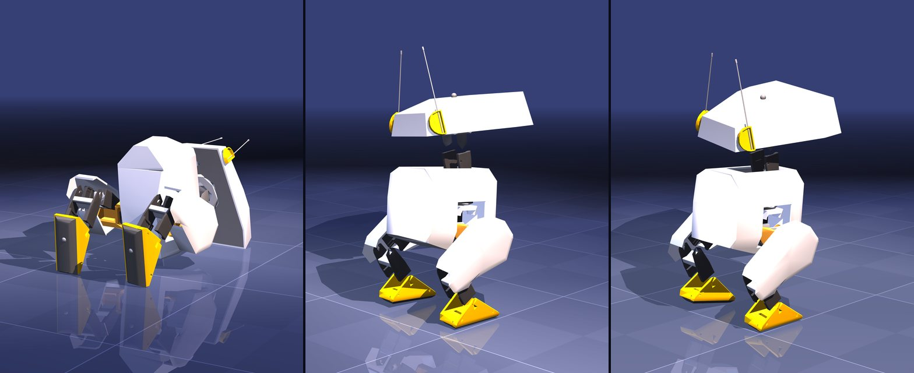

# open-duck-mac

**We teach Open Duck Mini v2 to walk from scratch on a MacBook, CPU only. Then we break it and measure why it breaks.**

This site is the full version of the experiments behind our short videos. Every script, log and measurement is in the repository, so you don't have to take our word for anything: run it again on your own Mac.

## Videos

The videos are in Turkish.

| Episode | Topic | YouTube |
|---|---|---|
| Duck 1 | I didn't buy the viral duck, I trained its sibling on my Mac | [Shorts](https://youtube.com/shorts/gfCUTIHldt0) |
| Duck 2 | I told the duck "be fast"; it learned to crawl on its belly | 28 October 2026 |
| Duck 3+ | The simulator lies (sim2real) | in progress |

Channel: [youtube.com/@getporti](https://www.youtube.com/@getporti)

## What's here

- **[Setup](setup.md)**: every command from an empty Mac to your first training run.
- **[Concepts](concepts.md)**: reinforcement learning, PPO, rewards, simulation, domain randomization, without the maths.
- **[1. Learning to walk](part-1-walking.md)**: 3.6 hours, 72.4 M steps, 1,536 parallel ducks. When did it lift its feet?
- **[2. Reward hacking](part-2-reward-hacking.md)**: we only changed the reward; the duck found crawling, freezing, and lying down with its feet in the air.
- **[3. Sim2real](part-3-sim2real.md)**: the simulated motor is almost twice as strong as the real servo. What happens? (in progress)
- **[What can you try?](experiments.md)**: ideas to try on your own, with difficulty and time estimates.

## Results in brief

- **72.4 million steps in 3.57 hours** on an Apple M5 MacBook (10 cores, 6 used). The Mac's GPU cannot run this physics, so everything runs on the CPU.
- The duck learned to stand in **~11 minutes**, sat on a plateau for **~3 hours**, and first lifted its feet at **68.4 M** steps (29.8 cm in 5 s).
- Continuing from that policy with only the reward changed: "be fast" → crawling on its belly at **14.9 min**, "don't waste energy" → frozen at **7.5 min**, "lift your feet" → lying down with feet in the air at **30 min**.
- With the motor torque lowered to the real servo's value (1.86 N·m), the same policy covers **half the distance**; a slippery floor or extra mass barely matter.

!!! warning "Honest limits"
    Everything is simulation; there is no real robot. Each experiment is one seed, one run. The official recipe is 150 M steps on an NVIDIA GPU; we stopped at 48 %. Details at the end of each part.

## Credits

The robot, model, environment and rewards are **Open Duck Mini**'s: [Antoine Pirrone](https://github.com/apirrone) and contributors ([Open_Duck_Mini](https://github.com/apirrone/Open_Duck_Mini), [Open_Duck_Playground](https://github.com/apirrone/Open_Duck_Playground)). Simulation by [MuJoCo / MJX](https://github.com/google-deepmind/mujoco), [MuJoCo Playground](https://github.com/google-deepmind/mujoco_playground) and [Brax](https://github.com/google/brax). If you build on this, credit Open Duck Mini first.
