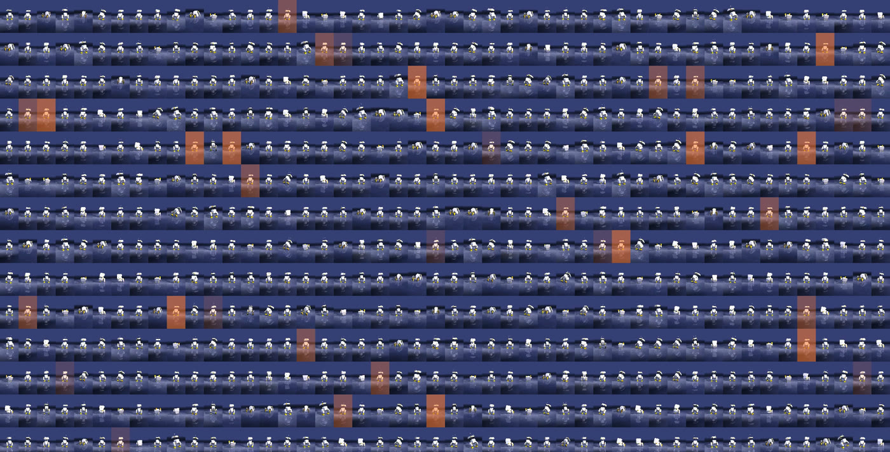

Bu sayfa videolarda geçen terimleri, depodaki dosyalarla eşleştirerek anlatır. Sırayla okursan sonraki bölümlerdeki her tablo anlam kazanır.

## Pekiştirmeli öğrenme (RL)

Robota "şöyle yürü" diye bir hareket **yazmıyoruz**. Ona yalnız bir **puan** (ödül) veriyoruz ve deneye yanıla puanı artıran hareketleri bulmasını bekliyoruz.

| Terim | Ördekte karşılığı |
|---|---|
| **Ortam** (environment) | MuJoCo'daki sanal ördek + zemin + yerçekimi. Dosya: Open_Duck_Playground'daki `joystick.py`. |
| **Gözlem** (observation) | Ördeğin her adımda "gördüğü" 101 sayı: IMU'dan dönüş hızı ve ivme, komut (ilerleme/dönme hızı ve kafa hedefleri), 14 eklemin açısı ve hızı, son üç aksiyonu ve motor hedefleri, iki ayağın yere değip değmediği, referans yürüyüşteki fazı. |
| **Aksiyon** (action) | 14 motorun hedef açısı: her bacakta 5, boyun ve kafada 4. |
| **Adım** (step) | 0,02 sn. Ördek saniyede 50 kez karar verir. |
| **Bölüm** (episode) | Bir deneme. Ördek düşünce ya da 20 sn dolunca biter, baştan başlar. |
| **Politika** (policy) | Gözlemi alıp aksiyonu üreten küçük sinir ağı. Eğitilen şey bu. |
| **Ödül** (reward) | Her adımda verilen puan. Ödül = birkaç terimin ağırlıklı toplamı. |

## Resmî ödül: 7 terim

Open Duck'ın yürüme ortamında ödül şu 7 parçadan oluşur (`joystick.py`, `reward_config.scales`):

| Terim | Ağırlık | Ne ödüllenir / cezalanır |
|---|---|---|
| `tracking_lin_vel` | 2,5 | İstenen hızda ilerlemek |
| `tracking_ang_vel` | 6,0 | İstenen hızda dönmek |
| `alive` | 20,0 | Düşmeden kalmak |
| `imitation` | 1,0 | Referans yürüyüşü taklit etmek |
| `torques` | −0,001 | Motorları zorlamak (ceza) |
| `action_rate` | −0,5 | Ani, titrek hareket (ceza) |
| `stand_still` | −0,2 | Komut "dur" iken kıpırdamak (ceza) |

[2. bölümde](/open-duck-mac/part-2-reward-hacking/) bu ağırlıkları bozunca ne olduğunu görüyoruz.

## Taklit ödülü

Sıfırdan "ileri git" ödülüyle ördek çok garip yollar bulabilir. Open Duck bunu Disney'in BDX makalesindeki fikirle çözer: bir **referans yürüyüş** üretilir (parametrik bir yürüyüş motoru, `polynomial_coefficients.pkl`) ve ördeğin eklemleri bu referansa ne kadar benzerse o kadar puan alır. Ördek yine kendisi öğrenir; referans yalnızca "neye benzemesi gerektiğini" söyler.

## PPO ve paralel ördekler

Temsilî: 0 adımdaki politikanın 9 gürültülü kaydı 1.536 hücrede tekrar ediliyor. Turuncu = ördek düştü, bölüm bitti, baştan başlıyor.

**PPO** (Proximal Policy Optimization) politikayı güncelleyen algoritma. Kabaca: ördekleri bir süre oynat, hangi hareketlerin beklenenden fazla puan getirdiğine bak, politikayı o yöne **küçük** bir adımla it, tekrarla. "Küçük" kısmı önemli; büyük adımlar öğrenileni bozar.

Tek ördekle bu çok yavaş olurdu. Bu yüzden aynı anda **1.536 ördek** (6 sanal cihaz × 256) simüle ediyoruz. Hepsi aynı politikayı kullanır; her biri farklı rastgele durumda olduğu için PPO bir seferde çok çeşitli deneyim görür. "72,4 M adım", tüm ördeklerin toplam adımı.

## MuJoCo, MJX, JAX

- **MuJoCo**: fizik motoru. Kütle, sürtünme, temas, motorlar.
- **MJX**: MuJoCo'nun **JAX** ile yazılmış hâli. Binlerce ördeği aynı anda, tek bir dev hesap olarak çalıştırabilir.
- **JAX**: Google'ın sayısal hesap kütüphanesi. Kodu derleyip (XLA) işlemcide ya da GPU'da hızlı çalıştırır.
- **Brax**: PPO'nun JAX ile yazılmış hâli. Bizim eğitim döngümüz bu.

## Domain randomization

Simülasyon gerçeğin kusursuz kopyası değil. Politika tek bir mükemmel dünyaya ezber yapmasın diye, her bölümde dünya biraz değiştirilir. Resmî eğitimde değişenler (`playground/common/randomize.py`):

- zemin sürtünmesi: 0,5–1,0
- tüm parçaların kütlesi: ×0,9–1,1; gövdeye ±0,1 kg
- gövdenin ağırlık merkezi: ±5 cm
- motor sertliği (kp): ×0,9–1,1; eklem sürtünmesi ×0,9–1,1
- eklemlerin sıfır noktası: ±0,03 rad
- ayrıca: aksiyon ve IMU gecikmesi (0–3 adım), gözlem gürültüsü, rastgele itmeler

**Değiştirilmeyen** önemli bir şey var: motorun verebileceği en büyük tork. [3. bölüm](/open-duck-mac/part-3-sim2real/) tam bunu inceliyor.

## Checkpoint, ONNX, sıcak başlangıç

- **Checkpoint**: eğitimin belli bir anındaki politikanın kaydı. `ckpt_068413440` = 68.413.440. adımdaki ördek.
- **`.pkl`**: Brax'ın ağırlıkları (eğitime devam etmek için).
- **`.onnx`**: aynı politika, her yerde çalışan standart formatta (değerlendirme, gerçek robot).
- **Sıcak başlangıç** (warm start): yeni bir eğitime sıfırdan değil, bir checkpoint'ten başlamak. 2. ve 3. bölümlerin hepsi 68,4 M'den başlar.

## İki tür test

| | Deterministik test | 9 gürültülü ördek |
|---|---|---|
| Betik | `eval_checkpoint.py` | `eval_grid.py` |
| Nasıl | Politikanın en olası hareketi, her seferinde aynı sonuç | Eğitimdeki gibi rastgele keşif gürültüsüyle, 9 farklı tohum |
| Ne söyler | "Bu ördek temiz koşulda ne yapıyor?" | "Ne kadar sağlam? Kaçı düşüyor?" |

İkisi de 5 sn, düz zemin, itme yok, komut 0,15 m/s ileri. "Düştü" = gövde 60°'den fazla eğildi (eğitimdeki 90° kuralından katı).

## Sim2real

Simülasyonda öğrenilen politikayı gerçek robota taşımak. Aradaki her fark (motor gücü, gecikme, kütle, sürtünme) robotun gerçekte farklı davranmasına yol açar. Domain randomization bu farkı kapatmanın en yaygın yolu; motoru doğru ölçmek (sistem tanımlama) diğeri. Open Duck ekibi motorlarını [BAM](https://github.com/Rhoban/bam) ile ölçüyor.
