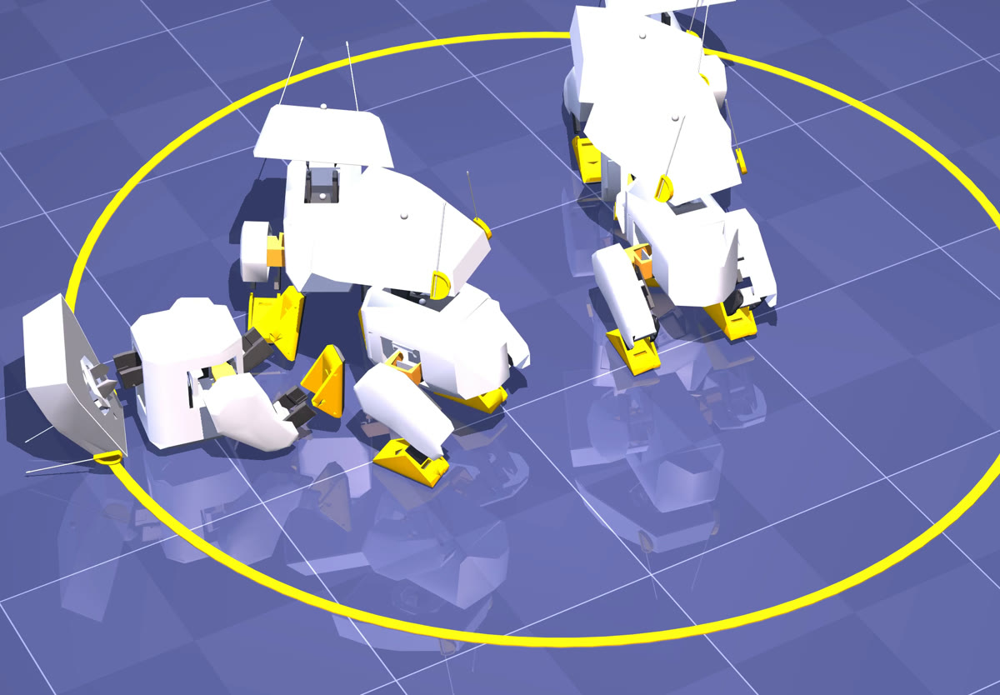

Five ducks in one scene, each walking independently with the pretrained `BEST_WALK_ONNX` and bumping into the others. Real MuJoCo physics, no scripted motion.

Ideas to try on your own Mac, from easy to hard. Times are rough estimates at our M5's speed (≈5,600 steps/s). Anything not marked "we tried" we have not tried either; we don't know the result.

:::tip[Want to share an experiment?]
Open an issue or pull request with your result: the command, seed, time and the `run.json` / measurement JSON are enough. If we use it in a video we'll credit you.
:::

## Easy (minutes to 1 hour)

### 1. Break the world, measure the policy · 5 min · we tried

No training, measurement only. Change torque, friction or mass with [`eval_world.py`](/open-duck-mac/en/part-3-sim2real/#experiment-1-no-retraining-different-worlds). Question: which change is the duck most sensitive to? What happens at mass ×1.5? At friction 0.2?

### 2. Walk at a different speed · 5 min

`eval_checkpoint.py --vx 0.3` (twice the command) or `--vx 0` (stand). Commands are sampled randomly in training, so the policy should know several speeds. Does distance grow with the command?

### 3. Write your own reward · 20–40 min · we tried

Add a line to `VARIANTS` as in [part 2](/open-duck-mac/en/part-2-reward-hacking/#write-your-own-reward). Ideas: "be quiet" (`action_rate` −5), "forget imitation" (`imitation` 0, rest official), "walk backwards" (`fwd_vel` −10). Guess which hack the duck will find, then look.

### 4. Another seed · 30 min (10 M) – 3.6 h (72 M)

`train_mac.py --seed 1`. Our duck lifted its feet at 68.4 M; when does yours? This shows why "one run is not statistics" matters.

## Medium (a few hours)

### 5. Train to the end of the official recipe · ~7.5 h

`--num_timesteps 150000000`. We stopped at 48 %. Does it approach `BEST_WALK_ONNX`'s 58.5 cm at 150 M? An overnight run.

### 6. Train with a weak motor · 1–2 h

The experiment of [part 3](/open-duck-mac/en/part-3-sim2real/): lower the torque limit to the catalog rating, or randomize it, with `scripts/sim2real/train_sim2real.py --force 1.86` or `--force_rand 1.40 1.90`. For us 72 M steps were not enough; try another seed or a fixed 1.86.

### 7. Rough terrain · a few hours

Open_Duck_Playground has a `rough_terrain_backlash` task (at the pinned commit only the backlash version exists). You need to change the `joystick.Joystick(task="flat_terrain")` line in `train_mac.py`. What does a flat-floor duck do on rough ground, and vice versa?

## Hard (a project)

### 8. Teach it to get up

Hugging Face's Microduck can get up after a fall; the Open Duck environment has no get-up task. You need episodes that start on the floor, a trunk-height reward and a trunk that collides with the floor (the [collision boxes](/open-duck-mac/en/part-2-reward-hacking/#collision-boxes) from part 2 are ready). soyeon24's open-loop attempt reached a crouch (10.6 cm of a 15 cm stance). Getting up is harder than walking.

### 9. Teach a show move (Disney style)

Besides walking, Disney's BDX robot learns short moves like "happy dance", "jump" or "tantrum" with an imitation reward ([arXiv 2501.05204](https://arxiv.org/abs/2501.05204); ~22 days on one RTX 4090). The small version: make a reference motion from your own keyframes ([Open_Duck_reference_motion_generator](https://github.com/apirrone/Open_Duck_reference_motion_generator)) and tie the imitation reward to it.

### 10. Move it to a real robot

Our ONNX files have the upstream interface (`obs` 1×101 → `continuous_actions`), so they should run with [Open_Duck_Mini_Runtime](https://github.com/apirrone/Open_Duck_Mini_Runtime). We have not tried hardware. Do experiment 6 first: a policy trained at 3.23 N·m in simulation covers half the distance at the 1.86 N·m catalog rating; we don't know which one the real servo is closer to.
