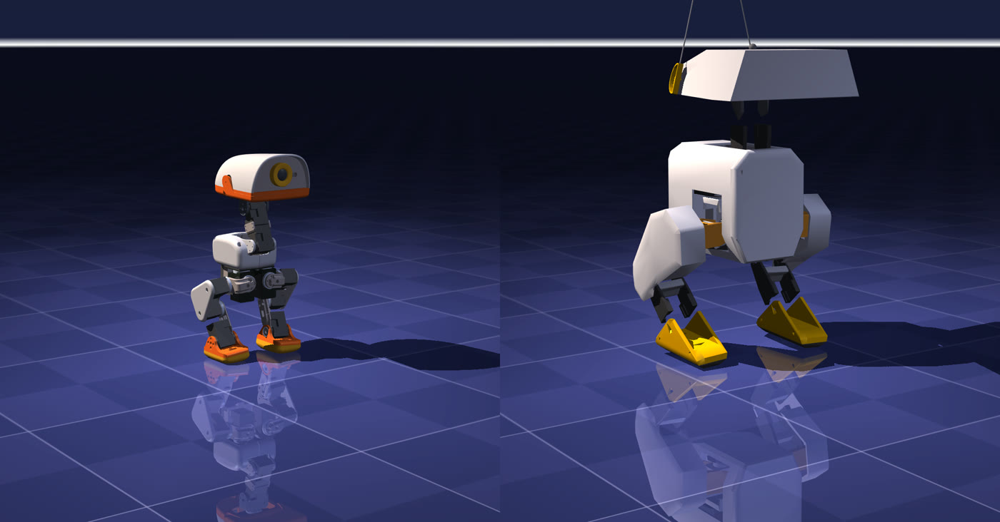

<sub>Same camera, same scale, standing pose. Left: Microduck (~25 cm); right: Open Duck Mini v2 (~42 cm). Our render. Microduck model: [pollen-robotics/microduck_rl](https://github.com/pollen-robotics/microduck_rl); 3D meshes © Pollen Robotics, [CC BY-NC-SA 4.0](https://creativecommons.org/licenses/by-nc-sa/4.0/). This image is also licensed CC BY-NC-SA 4.0. Open Duck Mini v2 model: Open_Duck_Playground, Apache-2.0.</sub>

:::note[What this page is based on]
Official Pollen pages, the `pollen-robotics` GitHub repositories, the policies and Spaces on Hugging Face, press and community sources (27 October 2026). No Microduck has shipped yet; abilities are those shown on the vendor's pre-production units. Sources conflict in several places; we collected them [at the end](#careful-conflicting-information).
:::

## In brief

Microduck is a two-legged duck robot announced on 27 August 2026 by **Pollen Robotics**, which belongs to Hugging Face ([Pollen blog](https://pollen-robotics.com/microduck/blog/introducing-microduck/)). It ships assembled for **$399** before tax and shipping. The software is open (Apache-2.0), the hardware is closed. Its behaviours are small neural networks trained with reinforcement learning in simulation.

- **What it does (claimed):** walking with a gamepad, sitting and standing, kicking, picking up small objects with its beak, roller-skating with an accessory, getting up after a fall, following a laser dot.
- **What it doesn't:** it does not speak; voice recognition, SLAM, navigation and autonomous grasping are not there yet. Pollen frames them as community goals ([The Register](https://www.theregister.com/ai-and-ml/2026/08/27/hugging-face-offers-399-robot-duck-to-help-you-quack-the-ai-code/5293011)).
- **When:** the current store banner says existing pre-orders ship **after April 2027** ([Pollen store](https://store.pollen-robotics.com/products/microduck)).

:::caution[Lookalike stores]
`microducks.org` and `microduck.shop` are not Pollen's. The only official store is [pollen-robotics.com](https://pollen-robotics.com/microduck/).
:::

## Hardware

| Part | Value |
|---|---|
| Height, weight | 25 cm; 780 g per the store (other official pages: "800 g", "under 800 g") |
| Motors | 15 **Dynamixel XL330**: 14 in the walking policy, 1 for the beak |
| Compute | Rockchip RK3566 (4× Cortex-A55), 1 GB RAM, 32 GB storage, 0.8 TOPS NPU |
| Sensors | wide-angle camera, 8×8 ToF depth sensor, 2 IMUs (body, head), microphones, speaker, 2 NFC antennas |
| Battery | removable NP-F550, about 1 hour |
| Payload | about 100 g (a verbal Pollen estimate, not an official spec) |

Sources: [store](https://store.pollen-robotics.com/products/microduck), [policy-manifest.md](https://github.com/pollen-robotics/microduck/blob/main/docs/policy-manifest.md), [robotd-design.md](https://github.com/pollen-robotics/microduck/blob/main/docs/design/robotd-design.md), [npu-bringup.md](https://github.com/pollen-robotics/microduck/blob/main/docs/project/npu-bringup.md).

A nice detail: the NPU is not used for walking. Policies run on the CPU with ONNX Runtime 50 times per second; the NPU only runs a small "duck detector" on the camera (YOLO11n, INT8).

## Software: a behaviour is an ONNX file on the Hub

A few services (daemons) written in Rust run on the robot. Only `robotd` touches the motors; everything else sends it an **intent** over JSON-RPC ([architecture.md](https://github.com/pollen-robotics/microduck/blob/main/docs/design/architecture.md)). A walk command is one line:

```json
{"jsonrpc":"2.0","method":"robot.move","params":{"vx":0.2,"vy":0.0,"vyaw":0.4}}
```

Every behaviour is an **ONNX policy file** on the Hugging Face Hub (`policy.onnx` + `manifest.json`). All policies share one contract: **61 numbers in, 14 joint targets out**, 50 times per second, so the robot can switch instantly between walking, getting up and tricks. The official policies are in [`pollen-robotics/microduck-policies`](https://huggingface.co/pollen-robotics/microduck-policies) (Apache-2.0): walking, standing, sit/stand, ground pick, left/right kick, forward roll, roller skating, and walking with fall recovery (`velstand`).

There is no separate docs site and no Python SDK on PyPI. The real documentation is the Markdown under [`microduck/docs/`](https://github.com/pollen-robotics/microduck/tree/main/docs); the best way in is [`cheatsheet.md`](https://github.com/pollen-robotics/microduck/blob/main/docs/robot/cheatsheet.md).

## How it is trained

Everything on the [Concepts](/open-duck-mac/en/concepts/) page applies here too: thousands of copies in simulation, a reward, PPO. The differences are in the tools and the reward.

| | Microduck ([microduck_rl](https://github.com/pollen-robotics/microduck_rl)) |
|---|---|
| Simulator | **mjlab** (MuJoCo Warp, MuJoCo on the GPU) |
| Algorithm | PPO (rsl_rl, PyTorch), 4,096 parallel envs |
| Time | a usable gait in 1–2 h on one CUDA GPU (README) |
| Network | actor and critic 512-256-128 |
| Reward | **no imitation**: velocity tracking, upright, pose, per-step air time, head tracking; penalties for slip, self-collision, jerkiness |
| Motor model | **BAM M6** for the XL330: voltage control law, back-EMF, friction |
| Randomization | mass ×0.95–1.05, friction 0.9–1.1, centre of mass up to ±8 mm, battery voltage, voltage sag, command delay, pushes |
| Backlash | ±1° gear backlash per servo, separate task twins |

Sources: [microduck_velocity_env_cfg.py](https://github.com/pollen-robotics/microduck_rl/blob/main/src/mjlab_microduck/tasks/microduck_velocity_env_cfg.py), [AGENTS.md](https://github.com/pollen-robotics/microduck_rl/blob/main/AGENTS.md).

Two decisions are especially worth learning from:

1. **They dropped the imitation reward.** Open Duck Mini v2 learns by imitating a reference gait; Microduck learns from task rewards only. Keyframe imitation was tried for the forward roll and dropped: given waypoints, the policy "camped" at them. A pose task gives one target from the start; finding the path is RL's job.
2. **The motor model carries reality.** The repository says most of the sim2real gap at this scale comes from the actuator, so the motor is modelled down to its voltage law instead of as an ideal controller. It is the same lesson as our [part 3](/open-duck-mac/en/part-3-sim2real/): Open Duck's simulated motor limit is ~70 % above the catalog rating, and lowering it to the catalog value alone halves the distance.

## How it differs from Open Duck Mini v2

Pollen never officially says "derived from Open Duck Mini". But the 14 joints have **the same names in the same order**, the toolchain is the same (Onshape → onshape-to-robot → MJCF, BAM, 50 Hz, ONNX), and the top contributor to the training code is Antoine Pirrone, Open Duck Mini's creator. The fair framing: same team, same idea, a separate commercial product.

| | Open Duck Mini v2 (the duck on this site) | Microduck |
|---|---|---|
| Height, weight | ~42 cm | 25 cm, ~780–800 g |
| Servo | Feetech STS3215 | Dynamixel XL330 |
| Computer | Raspberry Pi Zero 2W, Python | RK3566, Rust |
| Simulation + RL | MuJoCo Playground (MJX/JAX) + Brax PPO | mjlab (MuJoCo Warp) + rsl_rl PPO |
| Reward | Disney BDX-style imitation + tracking | no imitation, task rewards + curriculum |
| Motor model | BAM values baked into fixed kp/damping/friction | BAM M6 inside the simulation loop |
| Hardware | open (CAD, BOM, Apache-2.0) | closed; meshes CC BY-NC-SA |

## What can you do on a Mac?

The official stack supports a Mac for **running and evaluating**, not for **training** ([mjlab](https://github.com/mujocolab/mjlab)).

| Step | What | Official? | Note |
|---|---|---|---|
| 0. Browser | Drive the real policies in the [microduck-simulator](https://huggingface.co/spaces/pollen-robotics/microduck-simulator) Space | yes | no install; MuJoCo runs in the browser (WebAssembly) |
| 1. `infer_policy.py` | Drive an ONNX policy from the keyboard in CPU MuJoCo + BAM | yes | `--no-bam` switches to a simple motor so you can compare; `uv sync` on macOS is not officially tested |
| 2. `duck-sim` | Run the robot's real Rust software against a simulated body | yes, macOS supported | Rust, `mjpython`; Homebrew GStreamer for the camera |
| 3. Training | Train your own policy | only on a CUDA GPU or paid `--hf-jobs` | community ports exist for a Mac CPU, unverified |

```bash
# Step 1 (not tried by us; commands from the microduck_rl README)
git clone https://github.com/pollen-robotics/microduck_rl ~/Pollen/microduck_rl
cd ~/Pollen/microduck_rl
uv run scripts/infer_policy.py --walking <policy>.onnx   # to compare: --no-bam
```

To train on a Mac CPU, community ports: [microduck-lab](https://github.com/jonathanhawkins/microduck-lab) (CPU MuJoCo + Stable-Baselines3), [microduck-rl-torch](https://github.com/bsprenger/microduck-rl-torch) (PyTorch, Apple MPS), [microduck-mjbatch](https://github.com/tailong-wu/microduck-mjbatch) (batched CPU MuJoCo), [microdux](https://github.com/noahfarr/microdux) (JAX/MJX). If you take the JAX route, our trap applies: `jax-metal` cannot compile Cholesky, so use JAX's **CPU** backend.

One more note: the Microduck Arena says plainly that results on a Mac will differ from the server's, because the servo model is chaotic enough to diverge after a few seconds of simulation ([microduck-arena](https://github.com/pollen-robotics/microduck-arena)).

## Careful: conflicting information

| Topic | What is said | Our reading |
|---|---|---|
| Shipping | blog: "before Christmas 2026" · press on 24 Oct: 4–6 months · store: "after April 2027" | the store banner is the latest |
| Weight | 780 g / 800 g / "under 800 g" | 780 g is the most specific official figure |
| Servo | official repos: XL330 · a retailer sells the Feetech HD-1910 "for Microduck" | HD-1910 is in clones; the STS3215 is Open Duck's |
| Payload | ~100 g · some sites "800 g" | 800 g is the robot's own weight |
| "Open source" | product headline "open-source biped" · press kit: software only | the hardware is closed |
| Training framework | official repo: mjlab · some press: Isaac Lab / Newton | the official pipeline is mjlab |
| GTC stage demo | TechCrunch describes it as flawless · Reuters, CNBC: some ducks fell, missed commands | several sources report glitches |

Compiled from our research notes (27 October 2026). If you find something wrong or out of date, [open an issue](https://github.com/fport/open-duck-mac/issues).
