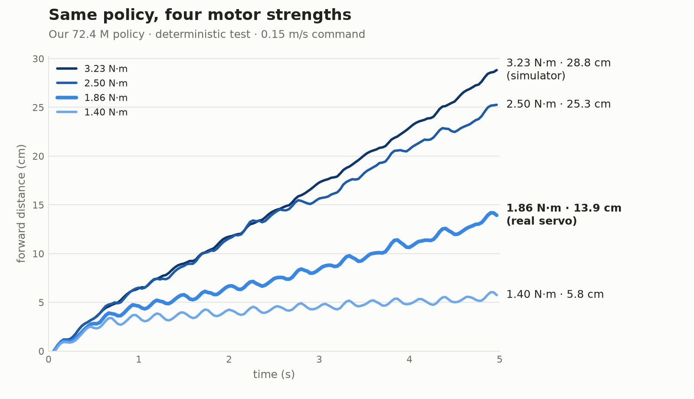
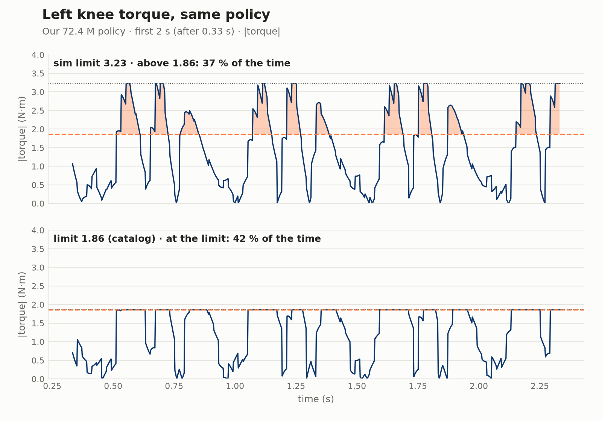
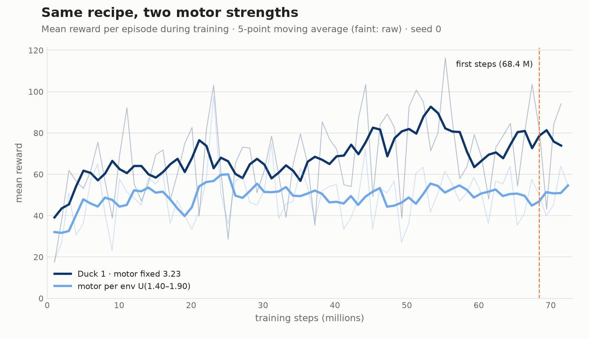
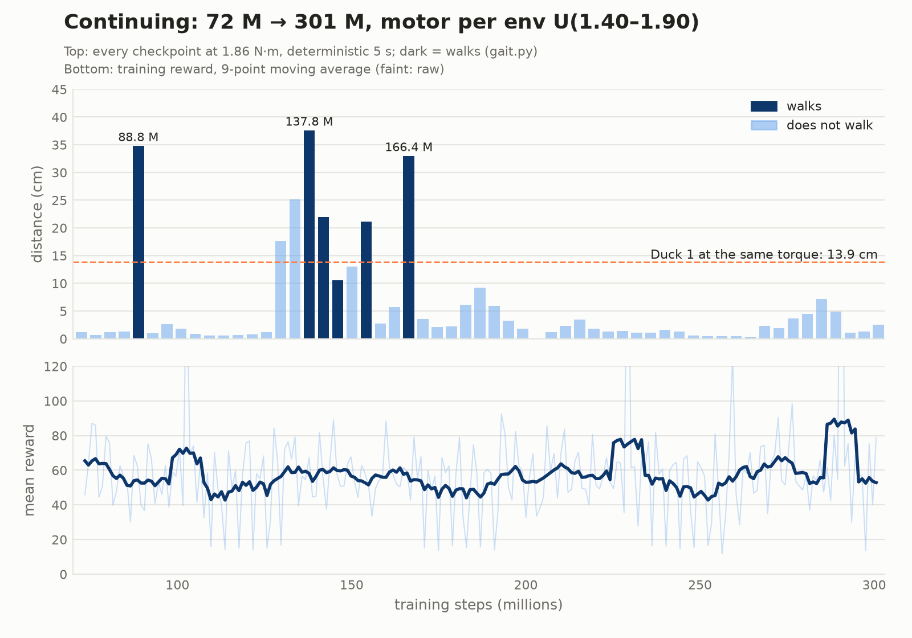

## The question

In the Open Duck model every joint can produce at most **±3.23 N·m** (`open_duck_mini_v2.xml:49`, class `sts3215`, `forcerange`). That value is not made up: the Open Duck team identifies the motor model from the real STS3215 (7.4 V) servo with [BAM](https://github.com/Rhoban/bam) and takes `forcerange` from it ([Open_Duck_Mini docs/sim2real.md](https://github.com/apirrone/Open_Duck_Mini/blob/v2/docs/sim2real.md)).

The torque printed on the servo's box is lower:

- The STS3215 catalog rating is **19 kg·cm ≈ 1.86 N·m**. [soyeon24/open-duck-mini-v2-build](https://github.com/soyeon24/open-duck-mini-v2-build) uses it as the "rated" value.
- [RobotShop](https://www.robotshop.com/products/magnetic-encoding-servo-sts3215-74v-19kgcm) lists **19.5 kg·cm ≈ 1.91 N·m** at 6 V. We found no catalog figure for 7.4 V.

So the simulator's limit is **~70 % above the catalog rating**. We don't know which one is closer to the real robot: we did not measure hardware, and BAM's value and a catalog stall torque may not measure the same thing. The question of this chapter: how much does the policy lean on the torque the simulator gives it, and what happens when the limit drops to the catalog value?

## Experiment 1: no retraining, different worlds

We measured trained policies without changing them, only changing the world. Deterministic test, 5 s, flat floor, no pushes, 0.15 m/s.

| World | Our 72.4 M | 9 stochastic (ours) | Ready-made `BEST_WALK_ONNX` |
|---|---|---|---|
| Normal (3.23 N·m) | 28.8 cm | 0/9 fell, mean 22.1 cm | 58.5 cm · 8+8 steps |
| Floor friction 0.5 (normal 0.6) | 24.9 cm | 0/9, mean 20.6 cm | 57.3 cm |
| Mass ×1.1 | 27.9 cm | 0/9, mean 18.1 cm | 56.1 cm |
| Mass ×1.2 | 24.7 cm | – | 54.3 cm |
| Torque 2.5 N·m | 25.3 cm | – | 52.3 cm |
| Torque 2.2 N·m | 19.9 cm | – | – |
| **Torque 1.86 N·m (catalog)** | **13.9 cm (−52 %)** | 0/9, mean 9.2 cm | **40.2 cm (−31 %)** · 8+5 steps |
| Torque 1.6 N·m | 9.8 cm | – | 27.3 cm · 8+0 steps |
| Torque 1.4 N·m | 5.8 cm | – | 19.5 cm · 7+0 steps |



What do we see?

- The loss is not linear: 3.23 → 2.5 costs only 12 %, while 2.5 → 1.86 halves the distance.
- No duck falls over; a weak motor slows it down instead of knocking it over. soyeon24 reports the same.
- At 1.6 N·m the ready-made policy can no longer step with its right foot (8+0).
- The friction and mass tests are not enough to say "robust to what was randomized": the changes are not the same size and we ran no ablation. Floor friction was not even randomized during training (see the box below).

:::caution[The official randomization does not change floor friction]
`playground/common/randomize.py` writes friction to geom `FLOOR_GEOM_ID = 0`. In the scene, geom 0 is a non-colliding mesh of the trunk; the floor is geom 46 (`floor`, friction 0.6). So floor friction never changes in the official training (pinned commit `b9be205`, same on upstream `main`). The other randomizations (mass, kp, joint friction, zero offsets) work. All of them are drawn **once per environment** at the start of training; on our Mac setup that is 256 distinct worlds (1536 envs / 6 devices).
:::

To reproduce, use [`scripts/sim2real/eval_world.py`](https://github.com/fport/open-duck-mac/blob/main/scripts/sim2real/eval_world.py), a copy of `eval_checkpoint.py` that changes the world through environment variables:

```bash
FORCE=1.86 .venv/bin/python -I scripts/sim2real/eval_world.py external/Open_Duck_Playground \
  results/2026-10-24/onnx/ckpt_072437760.onnx out/f186.mp4 --no_video        # "dx_m": 0.1393
FLOOR_FRIC=0.5 .venv/bin/python -I scripts/sim2real/eval_world.py ...            # slippery floor
MASS_SCALE=1.2 .venv/bin/python -I scripts/sim2real/eval_world.py ...            # every part 20 % heavier
FORCE_RAND=1.40,1.90 WSEED=3 .venv/bin/python -I scripts/sim2real/eval_world.py ...  # random per joint
```

All worlds in one command: `python3 scripts/sim2real/sweep.py out/sweep a=<onnx> b=<onnx>`. Results: [`results/2026-10-27-sim2real/eval_trained_policy/`](https://github.com/fport/open-duck-mac/tree/main/results/2026-10-27-sim2real/eval_trained_policy).

### Why it halves: knee torque

`eval_world.py` also records joint torque at every physics step (a `"torque"` summary in the output, a time series for both knees in the JSON). In simulation (3.23) our policy drives its knees above the catalog rating **37–39 %** of the time. As the limit drops, the knees sit at the limit more often:

| Limit | Distance | Knee > 1.86 (left/right) | Knee at the limit (left/right) |
|---|---|---|---|
| 3.23 | 28.8 cm | 36.7 % / 39.2 % | 7.4 % / 4.5 % |
| 2.5 | 25.3 cm | 39.8 % / 42.2 % | 25.2 % / 22.7 % |
| 2.2 | 19.9 cm | 43.1 % / 42.1 % | 34.5 % / 34.8 % |
| 1.86 | 13.9 cm | – | 42.3 % / 49.0 % |



The policy learned a gait for the torque the simulator gives it. Without that torque it sends the same commands, but the knees cannot deliver what it asks for.

## Experiment 2: retraining from a warm start (failed)

Three runs, all from the 68.4 M checkpoint, 10 M steps each. Rewards, physics and the official randomization are the same; only the torque limit differs. Policy and observation normalizer were restored, the value net started from scratch.

| Run | Torque limit | End (10 M) |
|---|---|---|
| `tork186` | fixed 1.86 N·m on every joint | 2.5 cm, no steps |
| `tork_rand` | U(1.40, 1.90) N·m per env and joint | 3.4 cm, no steps |
| `kontrol323` | official 3.23 N·m | 10.3 cm, no steps |

Even the control run lost its gait (26.3 cm at 5 M, 9.9 cm at 7.5 M). So the problem is not only the weak motor but the warm start with a reset value net itself. The weak-motor runs lost the gait by 2.5 M, the control by 7.5 M. That is why experiment 3 starts from scratch.

Files: [`results/2026-10-27-sim2real/warm_start/`](https://github.com/fport/open-duck-mac/tree/main/results/2026-10-27-sim2real/warm_start).

## Experiment 3: from scratch, random motor strength

The same recipe as [part 1](/open-duck-mac/en/part-1-walking/): same env, rewards, randomization, PPO settings, seed 0, 72 M steps. The only change: a torque limit of U(1.40, 1.90) N·m per env and per joint, around the catalog rating. The two `run_config.json` files differ only in `force_limit` and the start time.

```bash
.venv/bin/python -I scripts/sim2real/train_sim2real.py external/Open_Duck_Playground runs/scratch_rand \
  --force_rand 1.40 1.90 --devices 6 --envs_per_dev 256 --num_timesteps 72000000 --num_evals 19 --seed 0
```

Result (4.7 hours, Mac CPU): **no gait at 72 M steps.**

- The final checkpoint walks in no world: 0.9–1.5 cm, 0 steps. At the catalog limit 1.2 cm; 9 stochastic seeds average 0.8 cm, none falls.
- All 8 checkpoints between 36 and 72 M behave the same (best 3.7 cm, 0 steps). In the clean test it stands, doesn't fall, but takes no steps.
- During training (62–73 M average) the reward is 51.3 and the episode length 2.47 s. Over the same range the part 1 run reaches 77.8 and 3.50 s; it is ahead from 10 M on.



Interim result: domain randomization is the known fix for a weaker motor, but walking with a weak motor is a harder problem, and the same budget was not enough. soyeon24 **fixed** the motor at 1.86 and found a gait after 300 M steps (0.130 m/s; their own fork, simulation only). Their random runs with the same 1.40–1.90 range also walked at 300 M, but the result varied a lot with the seed.

Files: [`results/2026-10-27-sim2real/scratch_rand/`](https://github.com/fport/open-duck-mac/tree/main/results/2026-10-27-sim2real/scratch_rand) (logs, the final checkpoint in `onnx/` and `params/`, the checkpoint scan in `eval/`).

### Continuing to 301 M

The same run, from the 72.4 M checkpoint, restoring policy, value net and normalizer, seed 1 (9.2 hours):

```bash
.venv/bin/python -I scripts/sim2real/train_sim2real.py external/Open_Duck_Playground runs/scratch_rand_cont \
  --force_rand 1.40 1.90 --restore results/2026-10-27-sim2real/scratch_rand/params/ckpt_072437760.pkl \
  --restore_value --step_offset 72437760 --devices 6 --envs_per_dev 256 --num_timesteps 228000000 --num_evals 57 --seed 1
```

Result: **it walked at the catalog torque, then forgot.** We tried all 57 checkpoints at 1.86 N·m:



- **First gait at 88.8 M:** 34.8 cm. Duck 1's policy covered 13.9 cm at the same torque; the new policy goes 2.5 times as far. The very next checkpoint stands still again.
- **137.8–166.4 M:** 5 of 8 checkpoints walk; the best is 137.8 M, 37.6 cm.
- **None walks after 170 M.** The final checkpoint (301.2 M) stands still at 1–4 cm, even with the motor back at 3.23 (3.9 cm).
- **The reward does not show this.** The mean training reward does not drop while the gait disappears: 53–62 at 72–95 M, 64 at 260–301 M. Reading the reward curve and picking "the latest checkpoint is the best" would be wrong here.

The two walking checkpoints in other worlds (deterministic 5 s, none fell):

| World | 88.8 M | 137.8 M | Duck 1 72.4 M |
|---|---|---|---|
| 3.23 N·m (sim) | 49.9 cm | 49.1 cm | 28.8 cm |
| 2.5 N·m | 40.2 cm | 48.1 cm | 25.3 cm |
| **1.86 N·m (catalog)** | **34.8 cm** | **37.6 cm** | **13.9 cm** |
| 1.4 N·m | 20.5 cm | 21.2 cm | 5.8 cm |
| random 1.40–1.90 (`WSEED=0`) | 28.6 cm | 26.3 cm | – |
| 1.86 + mass ×1.2 | 30.8 cm | 28.5 cm | – |
| 1.86, 6 stochastic seeds | 14.6–19.7 cm | 15.5–21.0 cm | mean 9.2 cm (9 seeds) |

### Walking or sliding: the step counter was wrong

The `foot_steps` counter in `eval_world.py` counts a step when a foot rises more than 4 mm above its lowest point and comes back down. In the Open Duck gait the feet rise only ~1 cm, and the counter misses it: it counts even Duck 1's walking 72.4 M policy as 0+2 steps. During training `watch_ckpts.py` waited for "≥ 4 steps" and caught none of the walking checkpoints.

Instead, [`scripts/sim2real/gait.py`](https://github.com/fport/open-duck-mac/blob/main/scripts/sim2real/gait.py) looks, after the first 0.5 s, at how many times each foot's height oscillates around its mean, how high it lifts, and whether the two feet alternate (negative left/right correlation).

| Policy, 1.86 N·m | Distance | Oscillations (L/R) | Lift (L/R) | L/R correlation |
|---|---|---|---|---|
| Duck 1 72.4 M at 3.23 (reference gait) | 28.8 cm | 8 / 8 | 11.0 / 10.8 mm | −0.34 |
| 88.8 M | 34.8 cm | 7 / 8 | 9.1 / 11.2 mm | −0.33 |
| 137.8 M | 37.6 cm | 8 / 8 | 9.9 / 8.7 mm | −0.24 |
| 133.7 M (sliding) | 25.1 cm | 8 / 16 | 9.8 / 4.2 mm | 0.03 |
| 301.2 M | 2.5 cm | 8 / 6 | 1.3 / 4.9 mm | 0.06 |

Rule: more than 10 cm, and at least 4 oscillations and 5 mm of lift on both feet. 133.7 M covers 25 cm, but its right foot only jitters; by this rule it does not walk. `watch_ckpts.py` now uses this rule and logs every checkpoint until training ends (`--exit_on_walk` stops at the first walking one).

```bash
python3 scripts/sim2real/gait.py results/2026-10-27-sim2real/scratch_rand_cont/eval/f186/ckpt_137809920.json
```

### Lesson

1. Domain randomization worked for the weaker motor, but not by 72 M: the gait found at 68 M with the sim torque appeared at 88.8 M with torque around the catalog value. Once it appeared, it went further than the old policy.
2. Longer training is not better training. The gait disappeared after 170 M and did not come back.
3. The mean reward does not tell walking from standing. Keep your checkpoints and measure each one with your own test; ours is 5 s at 1.86 N·m plus `gait.py`.

We don't know yet why it forgot, and we don't guess about what we have not measured.

Files: [`results/2026-10-27-sim2real/scratch_rand_cont/`](https://github.com/fport/open-duck-mac/tree/main/results/2026-10-27-sim2real/scratch_rand_cont): logs, `onnx/` (88.8 · 137.8 · 166.4 · 301.2 M), `params/` (88.8 · 137.8 · 301.2 M), `eval/checkpoint_scan_f186.csv` (57 checkpoints), `eval/worlds_and_noise.json`, `eval/f186/` (full measurements of 4 checkpoints).
