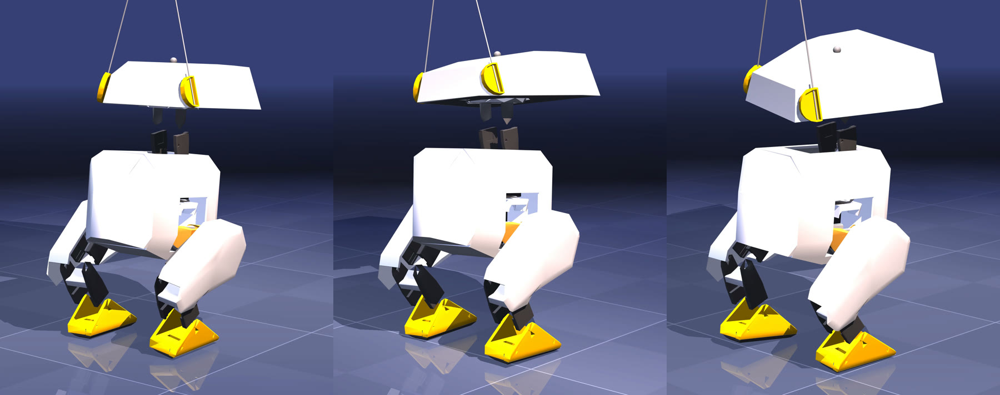

:::note[Özet]
Open Duck Mini v2, resmî ortam ve ödüllerle, **değiştirilmeden** eğitildi. Tek koşu, seed 0, 24 Ekim 2026, Apple M5 MacBook (10 çekirdek, 6'sı kullanıldı; makine aynı anda başka videolar da işliyordu). 3,57 saatte 72,4 M adım. Ördek 11 dakikada ayakta durmayı, 68,4 M adımda adım atmayı öğrendi.
:::

## Koşu

| | |
|---|---|
| Süre | **3,57 sa** (04:15:55 → 07:50:08) |
| Ortam adımı | **72.437.760** (resmî 150 M tarifin ≈ %48'i) |
| Paralel ördek | 1.536 (6 CPU cihazı × 256 ortam) |
| Bölüm | 429.369 (düşmeler ve 20 sn'lik zaman aşımları birlikte; log ayırmıyor) |
| Hız | ortalama 5.636 adım/sn (parça başına 1.924 – 7.358) |
| Simüle edilen zaman | 72,4 M × 0,02 sn ≈ 16,8 gün, gerçek zamanın ~113 katı |
| Checkpoint | 19 adet, her 4.024.320 adımda bir |

## Ördek ne yaptı?



<sub>Soldan: platoda ayakta duran ördek · 68,4 M'de ayağını kaldıran ilk checkpoint · hazır `BEST_WALK_ONNX` (bizim değil). Durağan kareler; fark hareket hâlinde görünüyor.</sub>

[`eval_checkpoint.py`](https://github.com/fport/open-duck-mac/blob/main/scripts/eval_checkpoint.py) ile ölçüldü: düz zemin, itme yok, ileri komut 0,15 m/s, 5 sn, deterministik politika. "9 gürültülü ördek" sütunu eğitimdeki gibi keşif gürültüsüyle örnekler ([`eval_grid.py`](https://github.com/fport/open-duck-mac/blob/main/scripts/eval_grid.py)).

| Checkpoint | Saat | 5 sn'de ileri mesafe | Ayaklar | 9 gürültülü ördek |
|---|---|---|---|---|
| 0 adım | 0 dk | 0,4 cm (donup kalıyor) | adım yok | **9'un 8'i düşüyor** |
| 4,0 M | **10 dk 45 sn** | 1,2 cm | adım yok | 9'un 0'ı düşüyor |
| 8 M – 64,4 M | 29 – 196 dk | 2,1 – 4,3 cm | adım yok (ayak ≤ 6 mm kalkıyor) | 9'un 0'ı |
| **68,4 M** | 205 dk | **29,8 cm** | ilk kalkan ayaklar, ~1,2 cm | 9'un 0'ı, ort. 18 cm |
| 72,4 M (son) | 214 dk | **28,8 cm** | küçük, sürüyen adımlar | 9'un 0'ı, ort. 22 cm |
| `BEST_WALK_ONNX` (hazır, bizim değil) | – | **58,5 cm** | 8 + 8 temiz adım | – |

Kısaca: ~**11 dakikada** ayakta durmayı öğrendi, sonra ~**3 saat** bu düzlükte kaldı, ancak 64,4 M ile 68,4 M arasında ayaklarını kaldırmaya başladı. 72,4 M'de aynı testte hazır politikanın yarısı kadar yol alıyor. 0,15 m/s'lik komut 5 sn'de 75 cm demek; yani hazır politika da burada hedefin altında.


Ortalama bölüm ödülü 17,5'ten (ilk 1 M adım) 78,3'e (son 10 M'nin ortalaması), bölüm uzunluğu 1,2 sn'den 3,5 sn'ye çıktı (sınır 20 sn). En net öğrenme sinyali taklit terimi: −127 → +168.

## Neden CPU?

Önce Mac'in GPU'sunu denedik. `jax-metal 0.1.1` + `jax 0.4.34` + `mujoco-mjx 3.2.3` ile MJX adımı derlenirken `failed to legalize operation 'mhlo.cholesky'` hatası çıkıyor: Metal eklentisi, fiziğin ihtiyaç duyduğu bir işlemi desteklemiyor. Bu donanım sınırı değil, eksik yazılım desteği.

## İşlemci hilesi

Çok iş parçacıklı XLA ile tek bir JAX CPU cihazı 2.368 adım/sn yaptı (1.024 ortam). İşlemciyi her biri tek iş parçacıklı 6 sanal cihaza bölünce (`--xla_force_host_platform_device_count=6 --xla_cpu_multi_thread_eigen=false`) Brax `pmap` ile çekirdeklere dağılıyor: 6 × 256 ortamla 4.621 adım/sn, yaklaşık 2 kat. `train_mac.py` bunu senin yerine ayarlıyor.

## Tekrar üret

[Kurulum](/open-duck-mac/setup/) sayfasındaki 6. adım bizim koşumuzun birebir komutu. Brax adım sayısını tam PPO iterasyonuna yuvarlar; 72.000.000 hedefi 72.437.760'ta biter.

```bash
# Kendi checkpoint'ini ya da bizimkini ölç
.venv/bin/python -I scripts/eval_checkpoint.py external/Open_Duck_Playground \
  results/2026-10-24/onnx/ckpt_072437760.onnx out/c72.mp4 --no_video       # "dx_m": 0.2882
.venv/bin/python -I scripts/eval_grid.py external/Open_Duck_Playground \
  runs/my-run/ckpt/ckpt_000000000.onnx out/c0_grid.mp4                     # "fell": 8
```

Hazır politikayla kıyaslamak için Open_Duck_Mini'den [`BEST_WALK_ONNX.onnx`](https://github.com/apirrone/Open_Duck_Mini/blob/b23317a485b3cec7d8417f352478778b3475173c/BEST_WALK_ONNX.onnx) indirip aynı komutu çalıştır (`"dx_m": 0.5845`).

### Kendi Mac'inde ne kadar sürer?

Bizim M5 (10 çekirdek, 6 cihaz × 256 ortam) başka işler çalışırken ortalama 5.636 adım/sn yaptı: 72 M adım 3,6 sa, 150 M ~7,5 sa. Boş bir makine daha hızlı olmalı. İlk derleme birkaç dakika sürer. Daha az çekirdek, orantılı olarak daha uzun süre demek; tahmin için `smoke_pmap.py` çalıştır (eğitim PPO güncellemesine de zaman harcadığı için duman testindeki sayıdan daha düşük bekle).

## Bu ne değil?

- **Resmî tarif değil.** Upstream, NVIDIA GPU'da 8.192 ortamla 150 M adım eğitir. Biz 1.536 ortam, daha küçük batch kullandık, değerlendirme koşusu yapmadık ve 72,4 M'de durduk. `BEST_WALK_ONNX`'in nasıl eğitildiğini bilmiyoruz.
- **Henüz yürüyen bir robot değil.** 72,4 M'de 5 sn'de küçük adımlarla 29 cm sürünüyor. İlk yürüyüş, iyi bir yürüyüş değil.
- **İstatistik değil.** Tek koşu, tek seed. Başka bir seed ayaklarını başka bir adımda kaldırırdı; "68 M" yalnız bu koşuya ait.
- **Microduck değil** ve **gerçek robot yok.** ONNX upstream arayüzünde ama donanımda çalıştırmadık.
- **Değerlendirmede birebir aynı fizik değil.** Eğitim MJX'te, değerlendirme aynı model ve kontrol döngüsüyle C MuJoCo'da; küçük sayısal farklar olabilir. Gövde devrilmeye başlayınca `eval_checkpoint.py` robotun parçalarını zeminle çarpıştırır ki düşen ördek videoda zeminin içinden geçmesin (eğitimde yalnız ayaklar zemine değer ve düşüş bölümü bitirir).
- **Fork değil.** Open_Duck_Playground sabit bir commit'ten olduğu gibi kullanılıyor; burada hiçbir şey onu değiştirmiyor.
