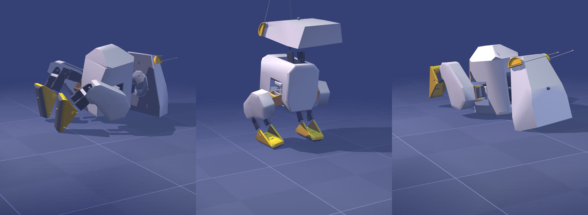

:::note[Özet]
68,4 M checkpoint'inden devam edip **yalnız ödül ağırlıklarını** (bir varyantta da düşme kuralını) değiştirdik ve PPO'nun eğitime devam etmesine izin verdik. Hiçbir yerde hareket, poz ya da yörünge yazılmadı: aşağıdaki her davranışı PPO kendisi buldu. Robot **istediğini** değil, **puanladığını** öğrenir.
:::

Ödül dosyası: [`scripts/reward_hacking/hile_env.py`](https://github.com/fport/open-duck-mac/blob/main/scripts/reward_hacking/hile_env.py) (`VARIANTS`). Değiştirilmemiş upstream `Joystick` ortamından türetilir ve iki terim ekler: ham ileri hız (`fwd_vel`) ve upstream'de olup kullanılmayan `reward_feet_air_time`. Sıcak başlangıç: politika ve gözlem normalizasyonu 68,4 M'den, değer ağı sıfırdan.

Varyant başına tek koşu, seed 0, 24 Ekim 2026, aynı Mac, 5 CPU cihazı × 256 ortam, sabit komut 0,15 m/s ileri.

## Dört "talimat"

| Varyant ("talimat") | Değişen ağırlıklar | Hileye kadar geçen süre | PPO ne buldu? |
|---|---|---|---|
| `hizli` — "hızlı ol" | ham ileri hız 25 (= upstream hız ağırlığı 2,5 × 10); taklit, hayatta kalma, enerji, yumuşaklık 0 | **14,85 dk** (ilk checkpoint, 3,0 M adım) | Yüzüstü kapaklanıp sürünüyor: 14,9 dk'da 49 cm, 9,0 M'de 54,6 cm (başlangıçtaki 25,8 cm'nin 2,1 katı), ayaklar zamanın %87'sinde havada, 0 adım. 9 gürültülü ördek: 8'i ileri sürünüyor, 1'i arkaya devriliyor. |
| `hizli_serbest` — aynısı, düşmek serbest | `hizli` gibi, düşünce bölüm bitmiyor | 26 dk koşu | Aynı sürünme (54,0 cm): onu dik tutan 90° düşme kuralı değilmiş. |
| `enerji` — "enerji harcama" | tork² cezası −1,0 (upstream −0,001, ×1000), aksiyon değişimi −5 (×10), hız takibi ×0,1, taklit 0 | **7,50 dk** (ilk checkpoint) | Donuyor: 5 sn'de 2,5 cm, 0 adım, tork² −%85, eklem yolu −%93. |
| `ayak` — "ayaklarını kaldır" | `feet_air_time` 3000, hız takibi 0, taklit 0 | **30,3 dk** | 10,7 dk'da 13 gerçek adım atıyor (tek deterministik test; 9 gürültülü ördeğin 5'i düşüyor). 30,3 dk'da yere yatıp ayaklarını 6–11 cm havada tutuyor, zemine hiç değmiyor. 9 gürültülü ördek: 9'u da yatıyor (4'ü öne, 5'i arkaya). |

"Hileye kadar geçen süre" davranışın göründüğü ilk checkpoint; yani bir üst sınır. `hizli` logunda gövde 2 M adımda (9,8 dk) düşmeye başlıyor bile.

## "Ayaklarını kaldır" neden yatıyor?

Upstream'deki `reward_feet_air_time` formülü `(havada_kalma − 0,1) × ilk_temas`; üstten 0,4'e kırpılıyor ama **alttan kırpılmıyor**. Yani 0,1 sn'den kısa havada kalıp inen ayak **ceza** alıyor (× 3000). Hiç inmeyen ayak ne ödül ne ceza alıyor, `alive` (20) ise ödemeye devam ediyor. İlk 0,5 M adımda bu terim bölüm başına −310,8, sonda +3.877,8.

Bu bizim formülü okuma biçimimiz, ablasyon değil: sebebi ayıracak deneyi yapmadık.

## Çarpışma kutuları

Upstream modelde zemine yalnız iki ayak tabanı çarpar; düşen gövde zeminin içinden geçer (eğitimde zararsız, çünkü düşüş bölümü bitirir). Bu koşular için [`make_hile_repo.py`](https://github.com/fport/open-duck-mac/blob/main/scripts/reward_hacking/make_hile_repo.py), Open_Duck_Playground'un bir **kopyasını** çıkarır ve gövdeye, kafaya ve dört bacak parçasına yalnız zeminle çarpışan, kütlesiz, görünmez kutular ekler (kütle ve eylemsizliğin değişmediği assert ile kontrol edilir).

:::note
Sürünme ve yatma ancak bu kutular sayesinde mümkün. Upstream'in kendisi değiştirilmez.
:::

## Çalıştır

[Kurulum](/open-duck-mac/setup/)'dan sonra:

```bash
.venv/bin/python -I scripts/reward_hacking/make_hile_repo.py external/Open_Duck_Playground external/Playground_hile
nice -n 10 .venv/bin/python -I scripts/reward_hacking/train_hile.py external/Playground_hile runs/hizli \
  --variant hizli --restore results/2026-10-24/params/ckpt_068413440.pkl \
  --devices 5 --envs_per_dev 256 --num_timesteps 9000000 --num_evals 4 --render_python .venv/bin/python
```

`--variant`: `hizli` (bizim koşuda 9 M adım), `hizli_serbest` (5 M), `enerji` (4 M), `ayak` (6 M). Yamalanmış modelin sha256'sı `d02225da52343b13` ile başlar; her `run.json`'da kayıtlı olanla aynı.

[`render_ckpt_hile.py`](https://github.com/fport/open-duck-mac/blob/main/scripts/reward_hacking/render_ckpt_hile.py) ve [`render_grid_hile.py`](https://github.com/fport/open-duck-mac/blob/main/scripts/reward_hacking/render_grid_hile.py) yukarıdaki sayıları üreten değerlendiriciler: eğitimle aynı fizik, video için ek çarpışma yok, ek ölçümler (tork², havadaki ayak oranı, en büyük eğim).

:::caution[Pickle dosyaları]
`ckpt_068413440.pkl`, Brax parametrelerinin Python pickle'ı. Yalnız güvendiğin pickle'ları yükle.
:::

## Kendi ödülünü yaz

`hile_env.py`'deki `VARIANTS`'a bir satır ekle:

```python
"kibar": dict(scales=dict(torques=-0.01, action_rate=-2.0, imitation=2.0), terminate=True,
              note="benim deneyim: daha yumuşak, daha çok taklit"),
```

Yazmadığın her ağırlık resmî değerinde kalır (`BASE`). Sonra `train_hile.py --variant kibar`. PPO'nun ne yaptığını görmek için genelde 20–40 dakika yeter. Başka fikirler: [Sen ne yapabilirsin?](/open-duck-mac/experiments/)

## Veri

Hepsi [`results/2026-10-24-reward-hacking/`](https://github.com/fport/open-duck-mac/tree/main/results/2026-10-24-reward-hacking) altında: `summary.json` ve her varyant için `run.json` (ağırlıklar, süreler, kaynak hash'leri), `train_log.csv`, `train_metrics_ep.jsonl` (her log adımında her ödül terimi), her checkpoint'in ONNX politikası ve `sim/*.json` (9 gürültülü tohum dahil her ölçüm).

`run.json`'daki `hile_env.py` ve `train_hile.py` hash'leri eğitim sırasındaki dosyalara ait; o zamandan beri yalnız yorumlar ve docstring'ler düzenlendi, `train_hile.py`'ye `scripts/onnx_export.py`'yi bulması için bir `sys.path` satırı eklendi.

## Sınırlar

Varyant başına tek seed ve tek kısa koşu (4–9 M adım), hepsi yürüyen bir politikadan devam. Başka bir seed başka bir hile bulabilir.
