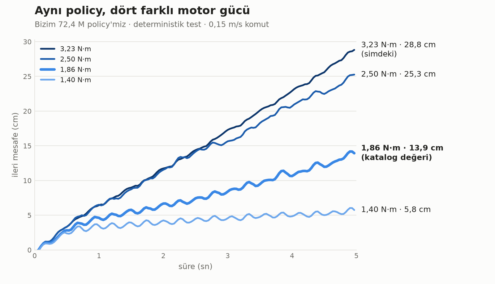
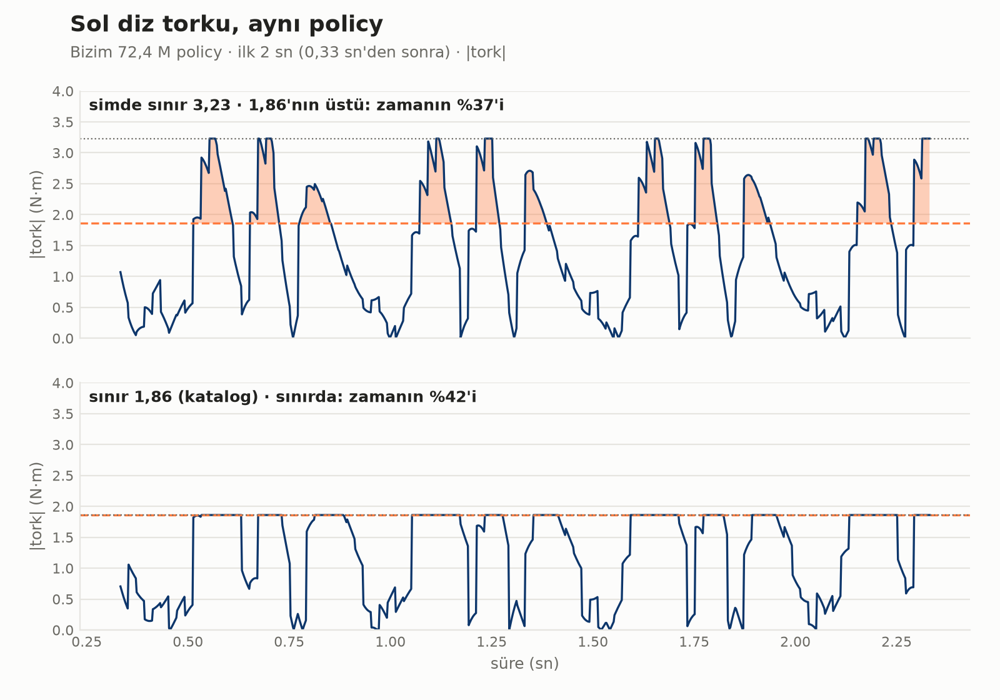
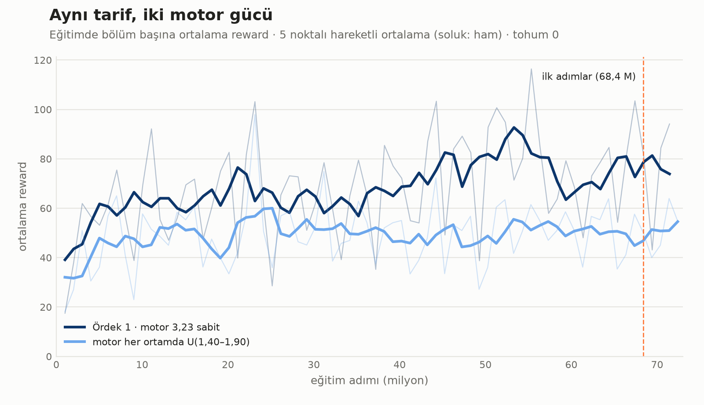

:::note[Devam ediyor]
Deney 1 ve 2 bitti. Deney 3'ün ilk 72 M step'i bitti; aynı koşu 27 Ekim 2026'dan beri ~300 M step'e doğru devam ediyor. Sonuç gelince bu sayfa güncellenecek.
:::

## Soru

Open Duck modelinde her eklem en fazla **±3,23 N·m** tork verebiliyor (`open_duck_mini_v2.xml:49`, `sts3215` sınıfı, `forcerange`). Bu değer uydurma değil: Open Duck ekibi motor modelini gerçek STS3215 (7,4 V) servosundan [BAM](https://github.com/Rhoban/bam) ile çıkarıyor ve `forcerange`'i de oradan alıyor ([Open_Duck_Mini docs/sim2real.md](https://github.com/apirrone/Open_Duck_Mini/blob/v2/docs/sim2real.md)).

Servonun kutusunda yazan güç ise daha düşük:

- STS3215 katalog değeri **19 kg·cm ≈ 1,86 N·m**. [soyeon24/open-duck-mini-v2-build](https://github.com/soyeon24/open-duck-mini-v2-build) bu değeri "rated" olarak kullanıyor.
- [RobotShop](https://www.robotshop.com/products/magnetic-encoding-servo-sts3215-74v-19kgcm) 6 V'ta **19,5 kg·cm ≈ 1,91 N·m** veriyor. 7,4 V için bir katalog değeri bulamadık.

Yani simdeki sınır **katalog değerinin ~%70 üstünde**. Hangisinin gerçek robota daha yakın olduğunu bilmiyoruz; biz donanımda ölçmedik ve BAM'ın değeriyle katalogdaki stall torku aynı şeyi ölçmüyor olabilir. Bu bölümün sorusu: policy simin verdiği güce ne kadar yaslanıyor, güç kataloğa inince ne oluyor?

## Deney 1: yeniden eğitmeden, farklı dünyalar

Eğitilmiş policy'leri hiç değiştirmeden, yalnız dünyayı değiştirip ölçtük. Deterministik test, 5 sn, düz zemin, itme yok, 0,15 m/s.

| Dünya | Bizim 72,4 M | 9 gürültülü (bizim) | Hazır `BEST_WALK_ONNX` |
|---|---|---|---|
| Normal (3,23 N·m) | 28,8 cm | 0/9 düştü, ort. 22,1 cm | 58,5 cm · 8+8 adım |
| Zemin sürtünmesi 0,5 (normal 0,6) | 24,9 cm | 0/9, ort. 20,6 cm | 57,3 cm |
| Kütle ×1,1 | 27,9 cm | 0/9, ort. 18,1 cm | 56,1 cm |
| Kütle ×1,2 | 24,7 cm | – | 54,3 cm |
| Tork 2,5 N·m | 25,3 cm | – | 52,3 cm |
| Tork 2,2 N·m | 19,9 cm | – | – |
| **Tork 1,86 N·m (katalog)** | **13,9 cm (−%52)** | 0/9, ort. 9,2 cm | **40,2 cm (−%31)** · 8+5 adım |
| Tork 1,6 N·m | 9,8 cm | – | 27,3 cm · 8+0 adım |
| Tork 1,4 N·m | 5,8 cm | – | 19,5 cm · 7+0 adım |



Ne görüyoruz?

- Kayıp doğrusal değil: 3,23 → 2,5 yalnız −%12, 2,5 → 1,86 ise mesafeyi yarıya indiriyor.
- Hiçbir ördek devrilmiyor; zayıf motor düşürmüyor, yavaşlatıyor. soyeon24 de aynı şeyi bildiriyor.
- Hazır policy 1,6 N·m'de sağ ayağıyla artık adım atamıyor (8+0).
- Sürtünme ve kütle testleri "randomize edilen şeye dayanıklı" demek için yetmez: değişiklikler eşit büyüklükte değil ve ablation yapmadık. Üstelik zemin sürtünmesi eğitimde hiç değişmedi (aşağıdaki kutu).

:::caution[Resmî randomization'da zemin sürtünmesi değişmiyor]
`playground/common/randomize.py` sürtünmeyi `FLOOR_GEOM_ID = 0` geom'una yazıyor. Ama sahnede geom 0 gövdenin çarpışmayan bir mesh'i; zemin geom 46 (`floor`, sürtünme 0,6). Yani resmî eğitimde zemin sürtünmesi hiç değişmiyor (sabit commit `b9be205`; upstream `main`'de de aynı). Öteki randomization'lar (kütle, kp, eklem sürtünmesi, sıfır noktası) çalışıyor. Hepsi eğitimin başında **ortam başına bir kez** çekiliyor; bizim Mac kurulumunda 256 farklı dünya var (1536 ortam / 6 cihaz).
:::

Tekrar üretmek için [`scripts/sim2real/eval_world.py`](https://github.com/fport/open-duck-mac/blob/main/scripts/sim2real/eval_world.py), `eval_checkpoint.py`'nin dünyayı ortam değişkenleriyle değiştiren kopyası:

```bash
FORCE=1.86 .venv/bin/python -I scripts/sim2real/eval_world.py external/Open_Duck_Playground \
  results/2026-10-24/onnx/ckpt_072437760.onnx out/f186.mp4 --no_video        # "dx_m": 0.1393
FLOOR_FRIC=0.5 .venv/bin/python -I scripts/sim2real/eval_world.py ...            # kaygan zemin
MASS_SCALE=1.2 .venv/bin/python -I scripts/sim2real/eval_world.py ...            # tüm parçalar %20 ağır
FORCE_RAND=1.40,1.90 WSEED=3 .venv/bin/python -I scripts/sim2real/eval_world.py ...  # her eklem rastgele
```

Bütün dünyalar tek komutla: `python3 scripts/sim2real/sweep.py out/sweep a=<onnx> b=<onnx>`. Sonuçlar: [`results/2026-10-27-sim2real/eval_trained_policy/`](https://github.com/fport/open-duck-mac/tree/main/results/2026-10-27-sim2real/eval_trained_policy).

### Neden yarıya iniyor: diz torku

`eval_world.py` her fizik adımında eklem torkunu da kaydediyor (çıktıda `"torque"` özeti, JSON'da iki diz için zaman serisi). Simde (3,23) bizim policy dizlerini zamanın **%37–39'unda** katalog değerinin üstünde kullanıyor. Sınır düştükçe dizler sınıra daha sık dayanıyor:

| Sınır | Mesafe | Diz > 1,86 (sol/sağ) | Diz sınırda (sol/sağ) |
|---|---|---|---|
| 3,23 | 28,8 cm | %36,7 / %39,2 | %7,4 / %4,5 |
| 2,5 | 25,3 cm | %39,8 / %42,2 | %25,2 / %22,7 |
| 2,2 | 19,9 cm | %43,1 / %42,1 | %34,5 / %34,8 |
| 1,86 | 13,9 cm | – | %42,3 / %49,0 |



Policy simin verdiği güce göre bir yürüyüş öğrenmiş. O güç yokken aynı komutları veriyor, ama dizler istenen torku veremiyor.

## Deney 2: warm start ile yeniden eğitim (başarısız)

Üç koşu, hepsi 68,4 M checkpoint'ten, 10 M step. Reward'lar, fizik ve resmî randomization aynı; tek fark tork sınırı. Policy ve observation normalizer geri yüklendi, value net sıfırdan başladı.

| Koşu | Tork sınırı | Son (10 M) |
|---|---|---|
| `tork186` | her eklem sabit 1,86 N·m | 2,5 cm, adım yok |
| `tork_rand` | her ortam ve eklem için U(1,40, 1,90) N·m | 3,4 cm, adım yok |
| `kontrol323` | resmî 3,23 N·m | 10,3 cm, adım yok |

Kontrol koşusu bile yürüyüşü kaybetti (5 M'de 26,3 cm, 7,5 M'de 9,9 cm). Yani sorun yalnız zayıf motor değil, value net'i sıfırlanmış warm start'ın kendisi. Zayıf motorlu koşular yürüyüşü 2,5 M'de, kontrol 7,5 M'de kaybetti. Bu yüzden Deney 3 sıfırdan.

Dosyalar: [`results/2026-10-27-sim2real/warm_start/`](https://github.com/fport/open-duck-mac/tree/main/results/2026-10-27-sim2real/warm_start).

## Deney 3: sıfırdan, motor gücü rastgele

[1. bölümün](/open-duck-mac/part-1-walking/) tarifinin aynısı: aynı ortam, reward'lar, randomization, PPO ayarları, tohum 0, 72 M step. Tek fark, her ortam ve her eklem için tork sınırının U(1,40, 1,90) N·m (katalog değeri civarı) olması. İki `run_config.json` yalnız `force_limit` ve başlangıç saatinde ayrışıyor.

```bash
.venv/bin/python -I scripts/sim2real/train_sim2real.py external/Open_Duck_Playground runs/scratch_rand \
  --force_rand 1.40 1.90 --devices 6 --envs_per_dev 256 --num_timesteps 72000000 --num_evals 19 --seed 0
```

Sonuç (4,7 saat, Mac CPU): **72 M step'te yürüyüş yok.**

- Son checkpoint hiçbir dünyada yürümüyor: 0,9–1,5 cm, adım 0. Katalog gücünde 1,2 cm; 9 gürültülü tohumun ortalaması 0,8 cm, hiçbiri düşmüyor.
- 36–72 M arasındaki 8 checkpoint'in hepsi aynı (en iyisi 3,7 cm, adım 0). Temiz testte ayakta duruyor, düşmüyor, ama adım atmıyor.
- Eğitimde (62–73 M ortalaması) reward 51,3, bölüm süresi 2,47 sn. Aynı aralıkta 1. bölümün koşusu 77,8 ve 3,50 sn; o koşu 10 M'den itibaren önde.



Ders: domain randomization zayıf motora karşı bilinen çözüm, ama zayıf motorla yürümek daha zor bir problem ve aynı bütçe yetmedi. soyeon24 motoru 1,86'ya **sabitleyip** 300 M step'te yürüyüş buldu (0,130 m/s; kendi çatalı, yalnız sim). Aynı 1,40–1,90 aralığıyla rastgele koşuları da 300 M'de yürüdü, ama sonuç tohuma göre çok değişti.

Dosyalar: [`results/2026-10-27-sim2real/scratch_rand/`](https://github.com/fport/open-duck-mac/tree/main/results/2026-10-27-sim2real/scratch_rand) (log'lar, son checkpoint `onnx/` ve `params/` içinde, checkpoint taraması `eval/` içinde).

### Devam: ~300 M'e

Aynı koşu, 72,4 M checkpoint'ten; policy, value net ve normalizer geri yüklenerek, tohum 1:

```bash
.venv/bin/python -I scripts/sim2real/train_sim2real.py external/Open_Duck_Playground runs/scratch_rand_cont \
  --force_rand 1.40 1.90 --restore results/2026-10-27-sim2real/scratch_rand/params/ckpt_072437760.pkl \
  --restore_value --step_offset 72437760 --devices 6 --envs_per_dev 256 --num_timesteps 228000000 --num_evals 57 --seed 1
```

[`scripts/sim2real/watch_ckpts.py`](https://github.com/fport/open-duck-mac/blob/main/scripts/sim2real/watch_ckpts.py) her yeni checkpoint'i 1,86 N·m'de deniyor ve 10 cm + 4 adımı geçen ilk checkpoint'te duruyor.
